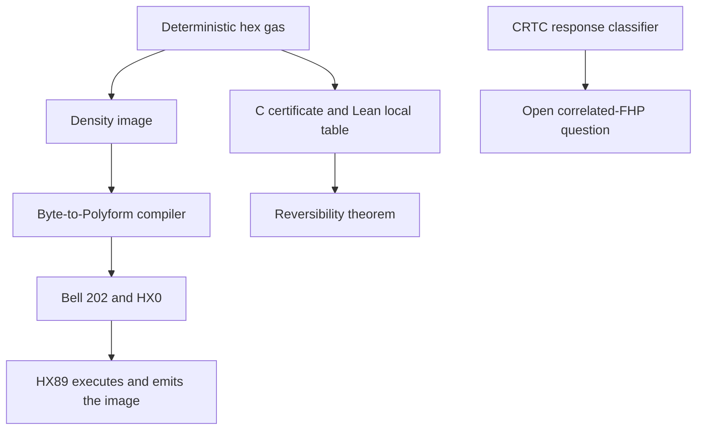
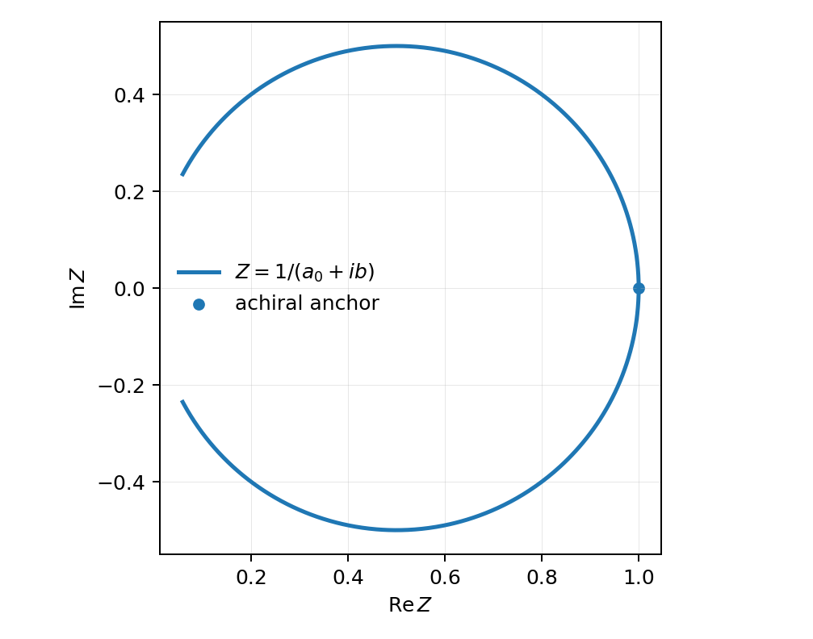
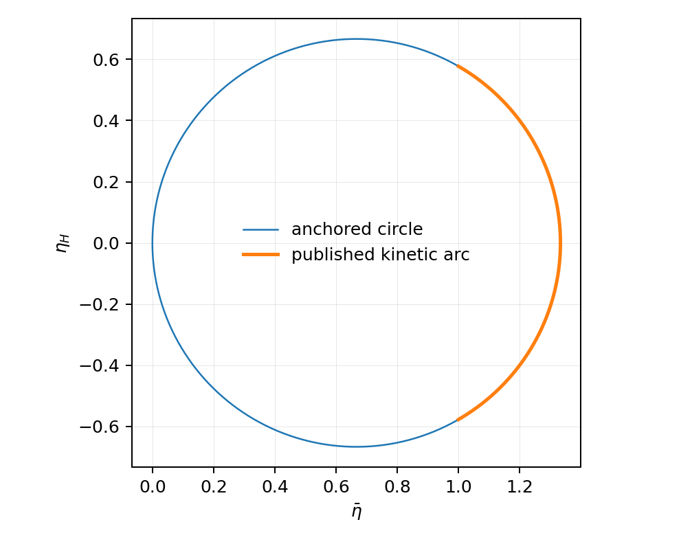
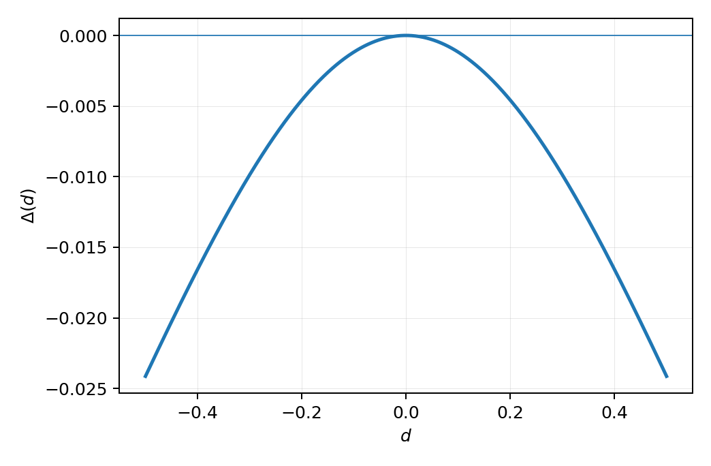

# HX89 - Hexworld Polyform Machine and Chiral Transport Research

**A deterministic machine that carries exact observations of a reversible lattice gas, with certified microscopic identities and an open question about transport rigidity.**

  

The physics loop starts with a six-channel hexagonal gas. HX89 turns its density image into a Polyform program, sends that program through Bell 202 audio and the HX0 bootstrap, and executes it to recover the **same observable bytes**. Independently, the gas has an exact collision-dressed reversing involution and echo law. The mathematical response module identifies the condition a correlated chiral fluid would need to satisfy to remain on a transport circle; whether this particular fully correlated fluid satisfies it is open.

The executable machine, gas, certificates, tests, research code, source documents, and three compiled papers live together. These badges describe repository contents, not live CI status.

## Quick start

On **Linux x86-64** with a C compiler, GNU binutils, `make`, and Python 3:

```sh
make all
make check
./bin/hx89 polyforms/hello.anything 1 100
./bin/hx89-chiral-proof
```

`make check` covers the HX0 bootstrap, signal paths, machine behavior, byte composition, gas, chiral reciprocity, and exact transport identities. The full research and document verification additionally needs SymPy, mpmath, and LaTeX. Prebuilt Linux x86-64 executables are included in [`bin/`](bin/).

## System map



| Area | Implementation | Guide |
| --- | --- | --- |
| Sparse machine, Q², phase state, snapshots, symbolic Conway expressions | [`src/hx89_x86_64.S`](src/hx89_x86_64.S) | [Machine](docs/MACHINE.md) |
| HX0, PCM, 125-baud FSK, Bell 202 | [`boot/`](boot/), [`src/pulse_pcm.c`](src/pulse_pcm.c) | [Signal bootstrap](docs/SIGNAL_BOOTSTRAP.md) |
| Canonical byte-to-Polyform compiler | [`src/byte_polyform.c`](src/byte_polyform.c) | [Composition lemma](docs/COMPOSITION_LEMMA.md) |
| Six-channel gas and reverse rule | [`src/hex_gas.c`](src/hex_gas.c) | [Hex gas](docs/HEX_GAS.md) |
| Chiral reciprocity certificate | [`src/chiral_law.c`](src/chiral_law.c) | [Chiral reciprocity](docs/CHIRAL_RECIPROCITY.md) |
| Response geometry and counterexample | [`research/crtc/`](research/crtc/) | [CRTC](research/crtc/README.md) |

`HX87P1` and `HX87SEM3` are serialized format and semantic-image identifiers retained by the bootstrap, not separate release names.

## Theorems, certificates, and the open question

| Claim | Status | Evidence |
| --- | --- | --- |
| Canonical byte composition | Semantic right inverse for payloads up to 4095 bytes; the gas density image survives compilation, audio transport, HX0 reconstruction, and HX89 emission byte for byte on the tested fixture | [Composition lemma](docs/COMPOSITION_LEMMA.md), [test](tests/test_composition.py), [technical note](docs/TECHNICAL_NOTE.md) |
| Local collision bijection, mass and momentum conservation | Lean proves the exact 64-state table; C and Python independently check the implementation | [Lean source](lean/HX89/Chiral.lean), [independent oracle](tests/test_chiral_law.py), [certificate](evidence/chiral_law_certificate.txt) |
| Mirror/chirality reciprocity and collision-dressed echo | Lean proves local mirror/velocity identities and the all-time algebraic echo under explicit streaming assumptions; C exhausts the complete 2 × 2 state space of 16,777,216 occupations for both chiralities, and Python checks larger tori | [Lean scope](lean/README.md), [proof and physics scope](docs/CHIRAL_RECIPROCITY.md), [C certificate](src/chiral_law.c) |
| One-body collision invariants | Exact rank-three linear space spanned by particle number and two momentum components for this collision table | [Theorem status](docs/THEOREM_STATUS.md), [rational elimination](tests/test_chiral_law.py) |
| Chiral FHP transport circle | Exact molecular-chaos algebra from attributed published coefficients | [Transport circle](docs/TRANSPORT_CIRCLE.md), [attribution](docs/LITERATURE_BOUNDARY.md) |
| Anchored response circle | Exact equivalence to constant `Re(1/Z)` for nonzero complex response with the stated positive real anchor; the restricted kernel form `Z=K/(a+ib)` makes this equivalent to constant `a` when `K` is chirality-independent | [CRTC theorem](research/crtc/docs/THEOREM.md), [kernel assumptions](docs/THEOREM_STATUS.md) |
| Kernel defect and conditional scale flow | Lean 4.30.0 with pinned Mathlib proves the `C₆` commutant normal form, exact complex defect formula, zero-defect equivalence, conditional beta criterion, and a symmetry-compatible nonflat witness | [Transport Lean source](lean/HX89/Transport.lean), [formal scope](lean/README.md) |
| Protection by symmetry and positive dissipation | Refuted in general by an exact stationary Ornstein-Uhlenbeck counterexample | [Counterexample](research/crtc/docs/COUNTEREXAMPLE.md) |
| Circle survival in fully correlated chiral FHP Green-Kubo dynamics | **Open**; no protecting Ward identity is established | [Scientific status](SCIENTIFIC_STATUS.md), [claims](scientific/claims.json) |

The C gas implements the deterministic endpoint chiralities `χ=±1`; it does **not** implement the continuous stochastic `p` family used in the attributed molecular-chaos formulas. The 2 × 2 enumeration certifies that finite system; the all-size echo theorem comes from the local operator proof. The Lean theorem is conditional on the declared toroidal streaming symmetries: this release has **not** connected its abstract `EndpointSystem` to a Lean implementation of torus indexing. See the [Lean proof boundary](lean/README.md). No Lean claim is made for the VM, continuous `p` dynamics, or correlated Green-Kubo conjecture.

The conjectured physical upgrade is `Re(1/Z(p)) = Re(1/Z(1/2))` for a specified correlated Green-Kubo response and regulator. The exact response theorem tells us what to measure; symmetry alone does not establish this equality, and the supplied positive-dissipation counterexample shows why the gap matters.

## Visual companion

[Open the interactive Chiral Transport Laboratory](visualization/chiral_transport/index.html) for a Three.js view of the six-channel lattice, collision and streaming controls, a separate molecular-chaos response-circle panel, and an optional WebXR placement button. It is an **independent explanatory implementation**: its site-wise stochastic `p` selector is not the C certificate for the deterministic endpoint automata. The gas remains two-dimensional; the vertical coordinate makes it legible in the 3D scene. WebXR requires a compatible browser, device, and secure origin. This package contains the browser scene, **no standalone GLB or USDZ model**; no such model was found in the supplied archives.

The original HX89 [architecture](docs/assets/hx89-architecture.svg), [response geometry](docs/assets/crtc-geometry.svg), and [hero](docs/assets/hx89-hero.svg) diagrams are included alongside it. The exact response geometry and counterexample figures below are generated from the equations in the thesis source:







Read the [scientific status ledger](SCIENTIFIC_STATUS.md) and [theorem status](docs/THEOREM_STATUS.md) before citing a result. The [claim registry](scientific/claims.json) and [equation registry](scientific/equation_registry.json) are machine-readable.

## Examples

```sh
./bin/hx89 polyforms/hello.anything 1 100
./bin/hx89 polyforms/entropy.hx 12345 100
./bin/hx89 --phase-forward polyforms/phase_torus.hx 1 20
./bin/hx89-gas 64 64 40 12345 density.pgm density.hx
```

These examples may write output in the working directory. Native execution is **off by default**; the explicit `--native` option enables host native paths for that invocation. Polyforms and snapshots are process inputs; the runtime is not a hardened OS sandbox. Read [`SECURITY.md`](SECURITY.md) and the [native bridge guide](docs/NATIVE_BRIDGE.md) before processing untrusted inputs.

## Verification

```sh
make check                           # deterministic machine and transport logic
make sanitize                        # sanitizer checks
make audit                           # regenerate and audit release evidence
make -C research/crtc verification   # research module; SymPy and mpmath
make verify-all                      # full rebuild, research and PDFs; needs LaTeX
(cd lean && lake build)              # Lean 4.30.0 + pinned Mathlib; both formal modules
sha256sum -c MANIFEST.sha256         # packaged snapshot before local changes
```

The committed [verification records](evidence/verification/) and [CRTC transcript](research/crtc/results/VERIFICATION.txt) describe previous runs in their stated environment, not live CI. `MANIFEST.sha256` covers this packaged snapshot and must be regenerated after editing or regenerating evidence. See [Reproducibility](REPRODUCIBILITY.md) for the full route.

## Papers and repository guide

| Document | PDF | Source |
| --- | --- | --- |
| Thesis | [Alex_Moraru_Thesis.pdf](dist/Alex_Moraru_Thesis.pdf) | [`thesis/main.tex`](thesis/main.tex) |
| Thesis companion | [Alex_Moraru_Thesis_Companion.pdf](dist/Alex_Moraru_Thesis_Companion.pdf) | [`thesis/companion.tex`](thesis/companion.tex) |
| Response rigidity paper | [CRTC_Response_Rigidity.pdf](dist/CRTC_Response_Rigidity.pdf) | [`research/crtc/paper/main.tex`](research/crtc/paper/main.tex) |

[`polyforms/`](polyforms/) holds runnable programs, [`seeds/`](seeds/) holds bootstrap images, [`tests/`](tests/) holds checks and independent oracles, [`evidence/`](evidence/) holds certificates and captured outputs, [the browser companion](visualization/chiral_transport/index.html) is under `visualization/`, and [`tools/`](tools/) holds consistency checks. The [release summary](RELEASE.md) describes the scope.

## License

Apache License 2.0. See [`LICENSE`](LICENSE). Literature-derived formulas retain the attribution and scope in the [literature boundary](docs/LITERATURE_BOUNDARY.md).
